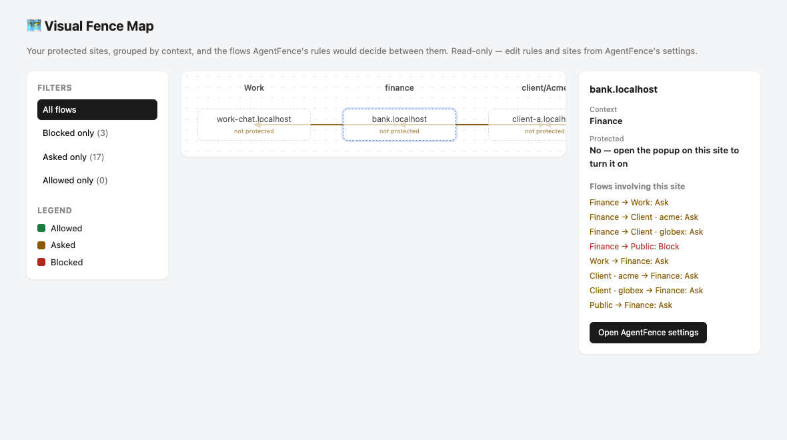

# 🛡️ AgentFence

**Stop AI agents from moving information where it doesn't belong.**

AgentFence is an open-source, local-first Chrome extension that protects browser-based AI
workflows from leaking information across work, personal, finance, health and client contexts.



> **Status: v0.1, early development.** The core loop works end to end — see
> [docs/product-spec.md](docs/product-spec.md) for the full spec and
> [docs/decisions.md](docs/decisions.md) for how each part was built. There's no recorded demo
> video yet; see [Demo](#demo) below for the five-minute version you can run yourself.

## Why?

An AI assistant may legitimately have access to both your bank and Slack.

```text
Bank access   ✓
Slack access  ✓

Bank information → Slack   ✕
```

That's not always unauthorized access — it can be the composition of two individually legitimate
permissions. Traditional extension permissions answer "can this access my bank" and "can this
access Slack." AgentFence answers a different question: should information learned in one
context be allowed to flow into another?

```text
FINANCE → WORK           ASK
FINANCE → PUBLIC         BLOCK
HEALTH → PUBLIC          BLOCK
CLIENT A → CLIENT B      BLOCK
WORK → PERSONAL          ASK
SAME CONTEXT             ALLOW
```

## Quickstart

```bash
git clone https://github.com/jehar-tau/agentfence.git
cd agentfence
pnpm install
pnpm build
```

Then in Chrome: `chrome://extensions` → Developer mode ON → Load unpacked → select `dist/chrome`.
A short walkthrough opens automatically the first time.

## Demo

```bash
pnpm demo
```

Starts five small fake sites with synthetic data — Bank, Work Chat, Client A, Client B, and a
Public Form — each on its own `*.localhost` hostname (no setup needed; see
[docs/decisions.md](docs/decisions.md)). Open the URLs it prints, assign each one a context from
the AgentFence popup, then try:

1. Copy the balance on Bank Demo, paste it into Work Chat Demo → AgentFence asks.
2. Copy the confidential price on Client A, paste it into Client B → AgentFence blocks it.

## How it works

1. **Assign a context** to a site from the popup — Work, Personal, Finance, Health, a scoped
   Client, or Public — and grant AgentFence access to that one site.
2. **Copy**, on a protected site: AgentFence hashes what you copied locally (never storing the
   text itself) along with the source site's context.
3. **Paste**, on a protected site: AgentFence checks whether the pasted text matches a recent
   copy, resolves both contexts, and evaluates your rules.
4. **Allow, Ask, or Block.** A same-context paste goes through silently. Anything else shows an
   in-page dialog — Block, Allow once, or Always allow (which writes a real, editable rule).

The Visual Fence Map (screenshot above) shows this as a live picture of your protected sites and
the flows between them. Activity history, on the settings page, keeps a 7-day, metadata-only
record of what was decided.

## Privacy

- Everything runs locally. No account, no backend, no cloud AI.
- Raw copied or pasted text is never stored — only a hash, used to match a later paste back to
  its source.
- No telemetry, no ads, no third-party analytics.

Full details: [docs/privacy.md](docs/privacy.md) · [docs/permissions.md](docs/permissions.md).

## Limitations

AgentFence helps with accidental cross-context copy/paste in the browser. It does **not** protect
against a compromised browser, OS-level malware, other browser extensions, screenshots/OCR, or
anything happening outside the browser entirely. An allowed paste is reinserted as plain text,
even if the original clipboard held rich formatting — a real, visible trade-off of how blocking
has to work technically (see [docs/threat-model.md](docs/threat-model.md)). The Visual Map's
flows are evaluated live from your rules, not drawn from recorded history yet.

Full details: [docs/threat-model.md](docs/threat-model.md).

## Roadmap

v0.1 is this repository. See [ROADMAP.md](ROADMAP.md) for what's next.

## Contributing

Issues labeled [`good first issue`](https://github.com/jehar-tau/agentfence/labels/good%20first%20issue)
are a good place to start. See [CONTRIBUTING.md](CONTRIBUTING.md) for setup, commands, and the
rules every change follows ([AGENTS.md](AGENTS.md)).

## Security

Please report vulnerabilities privately — see [SECURITY.md](SECURITY.md). Never in a public issue.

## License

[Apache License 2.0](LICENSE).
